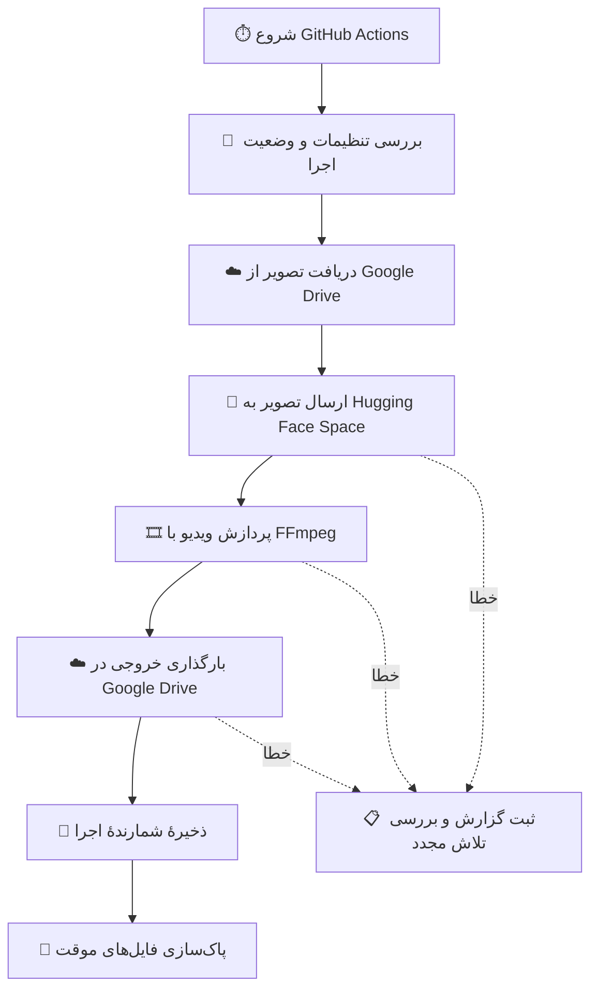

<div align="center" dir="rtl">

# 🎬 تبدیل تصویر به ویدیو

### راهنمای پروژهٔ خودکار تولید ویدیو با پایتون و هوش مصنوعی

<p>
  
  
  
  
</p>

**🖼️ دریافت تصویر　 ←　 🤖 تولید ویدیو　 ←　 🎞️ پردازش خروجی　 ←　 ☁️ ذخیره‌سازی**

[معرفی پروژه](#-معرفی-پروژه) • [نحوهٔ کار](#-نحوهٔ-کار-پروژه) • [راه‌اندازی](#-راهاندازی) • [تنظیمات](#-تنظیمات-ضروری) • [رفع خطا](#-رفع-مشکلات-رایج)

</div>

---

> [!WARNING]
> **پیش از اجرا، کد را بازبینی کنید.** در نسخهٔ فعلی فایل <code>main.py</code>، متن ثابت درخواست تولید ویدیو به درآوردن لباس اشاره می‌کند و گزینه‌های ایمنی مدل نیز غیرفعال شده‌اند. تا پیش از اصلاح این بخش‌ها، فعال‌کردن دوبارهٔ کنترل‌های ایمنی و بررسی مجوز استفاده از تصاویر، این مخزن را سرویس آمادهٔ استفاده یا مناسب انتشار عمومی در نظر نگیرید. این راهنما رفتار فعلی پروژه را توضیح می‌دهد و به‌معنای تأیید آن نیست.

## 🌟 معرفی پروژه

این پروژه یک گردش‌کار خودکار پایتون است که تصویر را از **Google Drive** دریافت می‌کند، آن را برای تولید ویدیو به یک سرویس **Hugging Face Spaces** می‌فرستد، خروجی را با **FFmpeg** پردازش می‌کند و ویدیوی نهایی را در Google Drive ذخیره می‌کند.

اجرای فرایند از طریق **GitHub Actions** انجام می‌شود؛ بنابراین پس از تنظیم مخزن و دسترسی‌ها، می‌توان گردش‌کار را دستی اجرا کرد یا از زمان‌بندی تعریف‌شده استفاده کرد.

### ✨ امکانات اصلی

| قابلیت | توضیح |
|---|---|
| 🖼️ دریافت تصویر | دانلود تصویر از پوشهٔ ورودی Google Drive |
| 🤖 تولید ویدیو | ارسال درخواست به سرویس ویدیوساز در Hugging Face |
| 🎞️ پردازش خروجی | تبدیل خروجی با FFmpeg به MP4 با کدک H.264 |
| ☁️ ذخیره‌سازی | بارگذاری ویدیوی نهایی در Google Drive |
| 🔁 تلاش مجدد | مدیریت برخی خطاهای سهمیه و در دسترس نبودن GPU |
| 📋 گزارش‌گیری | ثبت رویدادها در فایل <code>system_log.txt</code> |
| ⏱️ اجرای خودکار | زمان‌بندی از طریق GitHub Actions و اجرای دستی |

## 🔄 نحوهٔ کار پروژه



### مراحل به زبان ساده

1. **شروع اجرا:** گردش‌کار، مخزن را آماده می‌کند و وابستگی‌ها را نصب می‌کند.
2. **بررسی اجرا:** اسکریپت IP عمومی runner و فایل‌های وضعیت را بررسی می‌کند. IPهای ثبت‌شده در بازهٔ ۲۴ ساعت برای تشخیص اجرای تکراری استفاده می‌شوند.
3. **دریافت عکس:** تصویر از پوشهٔ Google Drive که شناسه‌اش در کد مشخص شده دریافت می‌شود.
4. **تولید ویدیو:** تصویر و پارامترهای تنظیم‌شده به Hugging Face Space ارسال می‌شوند.
5. **آماده‌سازی خروجی:** FFmpeg فایل خروجی را به MP4 با کدک H.264 تبدیل می‌کند.
6. **ذخیره‌سازی:** خروجی در پوشه‌ای که با <code>GDRIVE_FOLDER_ID</code> مشخص شده بارگذاری می‌شود.
7. **ثبت وضعیت:** شمارندهٔ ویدیوهای موفق به‌روزرسانی می‌شود و فایل‌های موقت پاک می‌شوند.

## 🗂️ ساختار مخزن

| فایل یا مسیر | کاربرد |
|---|---|
| <code>main.py</code> | منطق اصلی: دریافت عکس، تولید ویدیو، مدیریت خطا، بارگذاری و گزارش‌گیری |
| <code>requirements.txt</code> | وابستگی‌های پایتون |
| <code>.github/workflows/run.yml</code> | نصب پیش‌نیازها و اجرای گردش‌کار |
| <code>seed_state.txt</code> | نگهداری شمارندهٔ ویدیوهای موفق |
| <code>used_ips.txt</code> | نگهداری IP و زمان استفاده برای بررسی تکراری بودن اجرا |
| <code>system_log.txt</code> | گزارش اجرای اسکریپت |
| <code>banned_servers.txt</code> | فایل موجود در مخزن؛ نقش آن را پیش از اتکا به آن در کد بررسی کنید |

## 🚀 راه‌اندازی

> این پروژه برای اجرا به تنظیمات چند سرویس خارجی نیاز دارد. مراحل زیر برای مدیر مخزن است؛ پیش از اولین اجرا، هشدار امنیتی ابتدای این صفحه را برطرف کنید.

### ۱. دریافت پروژه

مخزن را در GitHub باز کنید و در صورت نیاز آن را Fork کنید یا با Git دریافت کنید:

```bash
git clone https://github.com/amirjak0/image-to-video-bot..git
cd image-to-video-bot.
```

**توجه:** نام مخزن در GitHub با نقطهٔ پایانی ثبت شده است؛ به همین علت نشانی Clone بالا پیش از <code>git</code> دو نقطه دارد. همچنین می‌توانید از **Code → Download ZIP** در صفحهٔ مخزن استفاده کنید.

### ۲. آماده‌سازی سرویس‌ها

- **Google Drive:** حسابی آماده کنید که اجازهٔ خواندن تصویر ورودی و ذخیرهٔ ویدیوهای خروجی را داشته باشد.
- **Google OAuth:** اطلاعات OAuth و دسترسی لازم برای Google Drive را تهیه و تأیید کنید.
- **Hugging Face:** وضعیت Space مورد استفاده را بررسی کنید. اگر سرویس به احراز هویت نیاز دارد، توکن معتبر تهیه کنید.
- **GitHub Actions:** در تنظیمات مخزن، به بخش **Secrets and variables → Actions** بروید و Secrets موردنیاز را اضافه کنید.

### ۳. افزودن Secrets

نام‌های زیر در گردش‌کار استفاده می‌شوند. مقدار واقعی کلیدها را در README، کد، Issue یا گزارش عمومی قرار ندهید.

| نام Secret | کاربرد |
|---|---|
| <code>GDRIVE_CLIENT_ID</code> | شناسهٔ OAuth کلاینت گوگل |
| <code>GDRIVE_CLIENT_SECRET</code> | رمز OAuth کلاینت گوگل |
| <code>GDRIVE_REFRESH_TOKEN</code> | توکن تازه‌سازی برای دسترسی به Google Drive |
| <code>GDRIVE_FOLDER_ID</code> | شناسهٔ پوشهٔ مقصد خروجی‌ها |
| <code>ACTIONS_JSON</code> | آرایهٔ JSON غیرخالی از متن‌های اکشن |
| <code>HF_TOKEN</code> | توکن Hugging Face؛ در کد اختیاری است، اما ممکن است سرویس به آن نیاز داشته باشد |

**دربارهٔ تصویر ورودی:** شناسهٔ پوشهٔ ورودی در نسخهٔ فعلی مستقیماً در <code>main.py</code> و متغیر <code>GDRIVE_IMAGE_FOLDER_ID</code> نوشته شده است. مطمئن شوید این شناسه متعلق به پوشه‌ای است که اجازهٔ دسترسی به آن را دارید. برای تنظیم آسان‌تر، بهتر است این شناسه نیز مانند سایر تنظیمات به GitHub Secret منتقل شود.

**دربارهٔ <code>ACTIONS_JSON</code>:** مقدار آن باید یک آرایهٔ JSON معتبر و غیرخالی باشد. اما کد فعلی یک متن ثابت ناایمن را به اکشن انتخاب‌شده اضافه می‌کند. ابتدا منطق ساخت <code>prompt</code> در <code>main.py</code> را به حرکت ساده و غیرجنسی تغییر دهید و کنترل‌های ایمنی را فعال کنید؛ سپس فقط متن‌های حرکت بی‌خطر و مجاز را در این Secret قرار دهید. تصاویر افراد را بدون مجوز لازم پردازش نکنید.

### ۴. اجرای گردش‌کار

1. صفحهٔ مخزن را در GitHub باز کنید.
2. وارد بخش **Actions** شوید.
3. گردش‌کار **Generate Video Automatically** را انتخاب کنید.
4. برای اجرای دستی، روی **Run workflow** کلیک کنید.
5. اجرای تازه را باز کنید و مراحل و گزارش‌ها را بررسی کنید.

در فایل گردش‌کار فعلی، اجرای زمان‌بندی‌شده برای هر دو ساعت یک‌بار تعریف شده است. اجرای زمان‌بندی‌شده به فعال بودن GitHub Actions و معتبر بودن تنظیمات مخزن وابسته است.

## ⚙️ پارامترهای تولید

در <code>main.py</code> چند پارامتر برای درخواست تولید ویدیو تنظیم شده‌اند:

| پارامتر | مقدار فعلی | توضیح |
|---|---:|---|
| تعداد مراحل | <code>6</code> | تعداد گام‌های پردازش مدل |
| مدت ویدیو | <code>8</code> ثانیه | مدت درخواستی ویدیو |
| Seed | شمارندهٔ وضعیت | برای تعیین Seed هر اجرا استفاده می‌شود |
| کیفیت | <code>10</code> | مقدار ارسالی به API سرویس |
| قالب خروجی | <code>MP4 / H.264</code> | قالبی که FFmpeg برای خروجی تنظیم می‌کند |

پارامترها و سازگاری آن‌ها به API و نسخهٔ سرویس Hugging Face بستگی دارند و ممکن است تغییر کنند. پس از هر تغییر، خروجی را آزمایش کنید.

## 📦 خروجی‌ها کجا ذخیره می‌شوند؟

- **ویدیوهای موفق:** در پوشهٔ مقصد Google Drive که با <code>GDRIVE_FOLDER_ID</code> تنظیم شده است.
- **گزارش‌ها:** در فایل <code>system_log.txt</code> و گزارش اجرای GitHub Actions.
- **وضعیت اجرا:** در فایل‌های <code>seed_state.txt</code> و <code>used_ips.txt</code>؛ گردش‌کار تغییرات را به مخزن ثبت می‌کند.
- **فایل‌های موقت:** تصویر و ویدیوهای موقت در پایان پردازش پاک‌سازی می‌شوند.

نام فایل خروجی بر اساس نام تصویر، Seed و شمارهٔ ویدیو ساخته می‌شود.

## 🧰 رفع مشکلات رایج

| مشکل | چه چیزی را بررسی کنید؟ |
|---|---|
| ⛔ خطای <code>ACTIONS_JSON</code> | وجود Secret، معتبر بودن JSON و غیرخالی بودن آرایه |
| 🔐 خطای اتصال به Google Drive | اعتبار OAuth، دسترسی حساب به پوشه‌ها و شناسهٔ پوشه |
| 🖼️ تصویر پیدا نمی‌شود | وجود تصویر در پوشهٔ ورودی و مجوز خواندن آن |
| 🤗 خطای Hugging Face | در دسترس بودن Space، مجوز توکن، سازگاری API و سهمیه |
| 🎮 نبود GPU یا تمام شدن سهمیه | صبر کنید تا منابع آزاد شوند؛ تلاش مجدد همیشه مشکل سرویس را حل نمی‌کند |
| 🎞️ خطای FFmpeg | نصب بودن FFmpeg و بررسی خطای کدک یا فایل خروجی |
| ☁️ بارگذاری ناموفق | فضای خالی Google Drive و مجوز نوشتن در پوشهٔ مقصد |
| 🔁 اجرا رد یا تکراری می‌شود | بررسی <code>used_ips.txt</code> و شمارندهٔ <code>seed_state.txt</code> |

برای جزئیات بیشتر، گزارش همان اجرای GitHub Actions را باز کنید. **توکن‌ها، اطلاعات OAuth و داده‌های شخصی را در گزارش عمومی منتشر نکنید.**

## 🔒 امنیت و حریم خصوصی

- فقط تصاویری را پردازش کنید که مالک آن‌ها هستید یا مجوز معتبر برای استفاده از آن‌ها دارید.
- برای افراد حاضر در تصویر، رضایت آگاهانه و هدف استفاده را در نظر بگیرید؛ محتوای صمیمی، جنسی یا فریبنده دربارهٔ افراد واقعی تولید نکنید.
- کنترل‌های ایمنی مدل را فعال نگه دارید و محدودیت‌های سرویس را دور نزنید.
- تصویر برای تولید ویدیو به سرویس خارجی ارسال می‌شود؛ این موضوع را پیش از استفاده به کاربران اطلاع دهید.
- فایل <code>used_ips.txt</code>، IP عمومی و زمان استفاده را نگه می‌دارد. ضرورت و مدت نگهداری این داده‌ها را بازبینی کنید.
- گردش‌کار فعلی تاریخچهٔ شاخهٔ <code>main</code> را بازنویسی و به‌صورت اجباری Push می‌کند و اجرای‌های قدیمی Actions را حذف می‌کند. این کارها می‌توانند تاریخچه و سوابق عیب‌یابی را از بین ببرند؛ پیش از فعال‌سازی، آن‌ها را بازبینی یا حذف کنید.
- دسترسی‌های GitHub Actions را به حداقل لازم محدود کنید و Secrets را فقط در تنظیمات امن مخزن نگه دارید.

## 🛠️ پیش‌نیازها

| پیش‌نیاز | توضیح |
|---|---|
| Python | گردش‌کار فعلی از Python 3.10 استفاده می‌کند |
| FFmpeg | برای آماده‌سازی فایل ویدیویی لازم است |
| GitHub Actions | برای اجرای دستی یا زمان‌بندی‌شده |
| Google Drive API و OAuth | برای دریافت تصویر و بارگذاری خروجی |
| Hugging Face Space | سرویس خارجی تولید ویدیو |

نسخه‌های وابستگی‌ها را پیش از استفادهٔ جدی بازبینی و ترجیحاً ثابت کنید. فایل <code>requirements.txt</code> فعلی همهٔ کتابخانه‌های مورد استفاده را به‌صورت کامل و نسخه‌بندی‌شده مشخص نمی‌کند؛ گردش‌کار برخی کتابخانه‌های Google را جداگانه نصب می‌کند.

## 🗺️ از کجا شروع کنم؟

<div dir="rtl">

| هدف | بخش پیشنهادی |
|---|---|
| فهمیدن کاربرد پروژه | [معرفی پروژه](#-معرفی-پروژه) |
| دیدن مراحل اجرا | [نحوهٔ کار پروژه](#-نحوهٔ-کار-پروژه) |
| راه‌اندازی مخزن | [راه‌اندازی](#-راهاندازی) |
| تنظیم کلیدهای دسترسی | [افزودن Secrets](#۳-افزودن-secrets) |
| پیدا کردن خطا | [رفع مشکلات رایج](#-رفع-مشکلات-رایج) |
| بررسی ریسک‌ها | [امنیت و حریم خصوصی](#-امنیت-و-حریم-خصوصی) |

</div>

---

<div align="center" dir="rtl">

### 💙 اگر این راهنما مفید بود، مخزن را ⭐ ستاره‌دار کنید

**ساخته‌شده با پایتون و ابزارهای متن‌باز**

<sub>این مستندات رفتار نسخهٔ فعلی مخزن را توصیف می‌کند. پیش از اجرا یا انتشار عمومی، کد، مجوزها، تنظیمات ایمنی و گردش‌کار GitHub Actions را بازبینی کنید.</sub>

</div>
